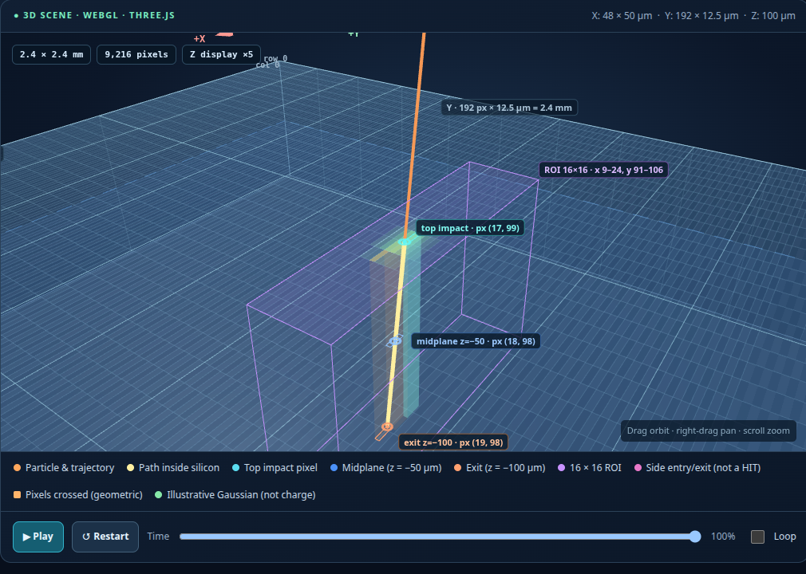

# 3D Pixel Sensor / Particle Trajectory Simulator

An interactive browser application for visualizing a charged particle traveling toward and through a **48 × 192 silicon pixel sensor**. The project is based on the earlier custom single-file prototype and the reference sensor-geometry sketch included under `assets/`.




> **Important:** The ray trajectory, plane crossings, volume entry/exit and per-pixel path lengths are **geometric** calculations of a straight line. The pixel brightness footprint is an **illustrative Gaussian**. It is **not** a Geant4/Allpix² result, ionization calculation, drift/diffusion model, or calibrated detector response.
>
> The main view is rendered with **Three.js r187 (WebGL)**, vendored under `vendor/three/` (MIT). The original 2D-canvas projection is kept as an automatic fallback when WebGL is unavailable, or on request with `?renderer=2d`. The first screenshot of the old prototype is `assets/preview.png`.

## Get started

Prerequisite: **Node.js 20 or newer** and a WebGL-capable browser. There is **no `npm install`** and no build step: Three.js is vendored as plain ES modules in `vendor/three/` and loaded through an import map in `index.html`, so the app also works **offline** (handy for talks).

```bash
cd pixel-sensor-simulator
npm run dev
```

Open **http://127.0.0.1:5173/** in your browser.

Run the geometry tests:

```bash
npm test
```

Open `http://127.0.0.1:5173/?renderer=2d` to force the original 2D-canvas renderer.

The original offline prototype is preserved as [`legacy/original-single-file.html`](legacy/original-single-file.html), which can be opened directly without running a server. The modular app uses ES modules, so it **must** be served over HTTP by the dev server instead of opening `index.html` as a `file://` URL.

## pixelAV simulated events

The viewer can also show **real pixelAV simulated events**: the truth track plus collected charge per pixel, over 20 time slices. To use it:

1. Convert the Parquet dataset once into a compact sparse format: `npm run convert:pixelav -- <dataset dir>`. This needs Python with pyarrow, for example `conda activate pixelav-env`.
2. Pick **Data source → pixelAV simulated events**.

The browser then fetches **one event per HTTP Range request** (about 4 KB) and never loads a whole file. Simulated charge and the illustrative Gaussian are separate modes. See **[docs/PIXELAV_DATA.md](docs/PIXELAV_DATA.md)** for the format, the memory strategy, the coordinate mapping, and the origin convention that still needs confirming.


## What works today

**3D view (Three.js / WebGL)**

- Volumetric, translucent 2400 × 2400 × 100 µm silicon slab; top surface carries the 48 × 192 pixel pads (one texel per pixel) and grid lines, with major lines every 16 pixels (the ROI tiling). Backside plane at z = −100 µm and an optional dashed midplane at z = −50 µm.
- Orientation aids: a physical **+X / +Y / +Z** axis triad, `col 0 / col 47` and `row 0 / row 191` labels at the array edges, and dimension labels. These make an accidental X/Y transpose easy to spot.
- **Orbit** (drag), **pan** (right-drag or shift-drag), and **zoom** (wheel or pinch), with damping. Zoom goes down to single 50 × 12.5 µm pixels. The orbit and elevation sliders and the keyboard (arrow keys, `+`/`−`, space to play) stay in sync with the mouse. Elevation goes to −89°, so you can look at the exit from below.
- View presets: **Top**, **Side X–Z**, **Side Y–Z**, **Focus impact**, and **Reset camera**. The camera refits automatically when the trajectory changes, unless you have panned.
- Animated particle with glow and a trail. The part of the path inside silicon is drawn brighter. As the particle passes each plane, its marker and the pixel at that crossing appear:
  - **top impact** (cyan ring, cell outline, and a translucent 50 × 12.5 × 100 µm pixel column),
  - **midplane crossing** (blue),
  - **exit** at z = −100 µm (orange).
  Crossings outside the sensor footprint are drawn grey and labelled “outside sensor”.
- **16 × 16 ROI toggle** (800 × 200 µm, drawn as a volume outline). You choose the placement: *centered on the impact pixel* (shifted inward at the array edge) or *aligned tile* of the fixed 3 × 12 tiling.
- **Pixels crossed by the track (geometric)**: the pixel columns that the in-silicon segment passes through, shown on the pads and as faint columns.
- Side entry/exit through the slab's side faces is marked and labelled separately. It is **never** counted as a top-surface HIT.
- Loop playback, timeline scrubbing, and **Save PNG** of the 3D scene (the HTML labels are not included in the PNG).

**Readouts and panels**

- Top-surface **HIT/MISS**, impact position, and zero-based `(x, y)` pixel; midplane and exit positions with their pixels.
- Silicon volume: entry face → exit face, and the 3D chord length in µm. Count of pixel columns crossed.
- 16 × 16 ROI panel in index space (cells drawn square, +y up, labelled index ranges). It shows the illustrative Gaussian and marks the crossed pixels.
- Presets: normal incidence, angled, oblique, and miss (unchanged).

## Physical geometry (µm)

| Property | Value |
|---|---:|
| Pixels across X | 48 |
| Pixels along Y | 192 |
| X pitch | 50 µm |
| Y pitch | 12.5 µm |
| Active width X | 2400 µm (2.4 mm) |
| Active width Y | 2400 µm (2.4 mm) |
| Thickness Z | 100 µm |
| Top, midplane, bottom | z = 0, −50, −100 µm |
| Pixel addressing | Zero-based X: 0–47, Y: 0–191 |

X and Y coordinates are measured relative to the **center of the sensor**: the sensitive footprint is `[-1200, 1200) × [-1200, 1200) µm²`. A particle starts above the sensor (`z0 > 0`) and moves downward toward negative Z.

Direction angles are **two independent slope angles**, not the usual spherical polar/azimuthal angles:

```text
x(z) = x0 + (z0 - z) * tan(thetaX)
y(z) = y0 + (z0 - z) * tan(thetaY)
```

The **Z exaggeration** slider affects the picture only, never the geometry or pixel address. In the 3D view it is applied in one place, `src/sceneTransform.js`, which maps physical µm to scene units as `(x, z·stretch, −y)·0.01`. That mapping is a proper rotation with no mirroring, and the tests check it.

**HIT** still means the ray crosses the **top surface** inside the footprint. A separate, tested slab-method function (`intersectVolume`) reports entry and exit through any face, including the sides. The UI shows that result in its own readout row and labels; it does not change HIT.

## Project layout

```text
pixel-sensor-simulator/
├── index.html                       Main UI (+ import map for vendored Three.js)
├── src/
│   ├── geometry.js                  SOURCE OF TRUTH: constants, ray math, pixel mapping, ROI windows,
│   │                                volume intersection, traversed pixels (pure JS, no DOM)
│   ├── sceneTransform.js            Display-only physical→scene mapping, camera angle helpers (pure JS)
│   ├── renderer3d.js                Three.js volumetric renderer (draws only what geometry.js returns)
│   ├── renderer.js                  Legacy 2D-canvas renderer (fallback / ?renderer=2d)
│   ├── roiPanel.js                  16 × 16 ROI index-space panel
│   ├── pixelav.js                   pixelAV binary decoding + truth→viewer mapping (pure, tested)
│   ├── eventSource.js               Range-request event loader with LRU caches
│   ├── dataPanel.js                 Data-source UI: event browser, time slices, event readout
│   ├── chargeColors.js              Display-only log colour map for simulated charge
│   ├── presets.js                   Example particle trajectories
│   ├── main.js                      UI state, controls, animation, renderer selection
│   └── styles.css                   UI styling
├── tests/
│   ├── geometry.test.js             Original geometry regression tests
│   ├── volume-roi.test.js           ROI, animation, volume intersection, traversal, scene transform
│   ├── pixelav.test.js              Decoder, mapping and loader on real-event fixture
│   ├── devserver.test.js            Range parsing, path safety
│   ├── chargeColors.test.js         Colour map
│   └── fixtures/pixelav/            6 real events written by the converter test
├── vendor/three/                    Three.js r187 (MIT), unmodified: core, OrbitControls, CSS2DRenderer
├── scripts/dev-server.mjs           Dependency-free streaming HTTP server (Range/206, /data/pixelav mount)
├── scripts/pixelav_convert.py       Parquet → sparse event converter (pyarrow, bounded memory)
├── scripts/test_pixelav_convert.py  Converter tests (+ bit-exact check vs real data)
├── scripts/qa-browser.mjs           Headless-Chrome UI check over DevTools (npm run qa:browser)
├── data/pixelav/                    Converted events (git-ignored; created by the converter)
├── assets/                          Reference drawing and screenshots
├── docs/                            PROJECT_SPEC.md, PIXELAV_DATA.md, HANDOVER_CLAUDE.md, CLAUDE_START_PROMPT.md (historical)
├── legacy/original-single-file.html Working offline original prototype
├── CLAUDE.md                        Instructions for Claude Code
└── package.json
```

### Upgrading Three.js

The vendored files are copied verbatim from the npm package (`npm pack three@<version>`): `build/three.module.js`, `build/three.core.js`, `examples/jsm/controls/OrbitControls.js` → `addons/controls/`, and `examples/jsm/renderers/CSS2DRenderer.js` → `addons/renderers/`. Replace all four together, then update `vendor/three/README.txt`.

## Continue development in Claude Code

Start Claude Code in the project folder (`claude`). It picks up `CLAUDE.md`, which holds the project rules, automatically.

**Taking over the project?** Read **[`docs/HANDOVER_CLAUDE.md`](docs/HANDOVER_CLAUDE.md)**. It covers the current state, the open decisions, how to use oh-my-claudecode (the `autopilot` workflow that built milestones 1 and 2), and how to verify an agent's changes, including a headless browser check (`npm run qa:browser`). `docs/CLAUDE_START_PROMPT.md` is the original milestone-1 prompt and is kept for history only.

## Still illustrative or not yet implemented

- Pixel brightness is an **illustrative Gaussian** around the top impact point. It is not charge, has no units, and is not an electron count.
- No energy deposition, electron–hole pair generation, drift, diffusion, induced signal, threshold or noise. Per-pixel path lengths are pure geometry and are **not** a proxy for collected charge.
- Straight line only: no magnetic field, multiple scattering, delta rays, or energy loss.
- The display Z stretch distorts the visual angle of the track. Use ×1 to see true proportions.

## Suggested future improvements

1. Click or hover a pixel to show its index, position, path length and ROI membership.
2. *Done (v0.3.0):* pixelAV events. Still open: filtering and sorting events by truth (cotα, cotβ, pT), and drawing the charge along depth (z) when per-depth data is available.
3. Show several tracks per event and step through event sequences.
4. Export annotated images, including labels, and video frames for talks.

Do **not** label the Gaussian illustration as physical charge collection, and do **not** change the detector dimensions or axis conventions without updating the specification and tests.
